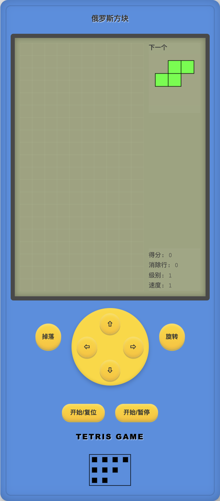

# TypeScript 俄罗斯方块

[](LICENSE)
[](#技术栈)
[](#技术栈)
[](#快速开始)
[](#贡献)

用 TypeScript + HTML5 Canvas 实现的经典俄罗斯方块，复古游戏机风格界面，无外部游戏引擎，全部逻辑从零实现。



> [!NOTE]
> 纯前端、零依赖运行时 —— 游戏逻辑与渲染全部在本机浏览器完成。

---

## 特性

- 经典俄罗斯方块玩法 + 现代化视觉
- 桌面端响应式操作（键盘 + 屏幕按钮）
- 分数统计与等级系统
- 随等级提升自动加速
- 下一个方块预览
- 暂停 / 继续
- 复古游戏机风格 UI

---

## 游戏操作

- **← / →**：左右移动方块
- **↓**：加速下落
- **↑**：旋转方块
- **空格**：硬降（瞬间落底）
- **P**：暂停 / 继续
- 也可使用屏幕上的按钮操作

---

## 技术栈

- TypeScript（类型安全）
- HTML5 Canvas 渲染
- 无外部游戏库 —— 逻辑从零实现
- Bun 构建打包

---

## 快速开始

前置要求：[Bun](https://bun.sh/)（快速 JS 运行时与包管理器）。

```bash
git clone https://github.com/lucky845/ts-tetris-game.git
cd ts-tetris-game
bun install
bun run start    # 启动开发服务器
bun run build    # 生产构建 → dist/
```

## 项目结构

```
ts-tetris-game/
├── src/
│   ├── controllers/    # 游戏控制器
│   ├── models/         # 游戏逻辑与数据模型
│   ├── renderers/      # 渲染逻辑
│   └── index.ts        # 入口
├── public/
│   ├── styles/         # CSS 样式
│   └── index.html      # HTML 模板
├── dist/               # 编译产物
└── package.json        # 项目配置
```

---

## License

[MIT License](LICENSE)

## 贡献

欢迎提交 Issue 和 Pull Request。

## 致谢

- 灵感来自经典俄罗斯方块
- 使用现代 Web 技术构建
